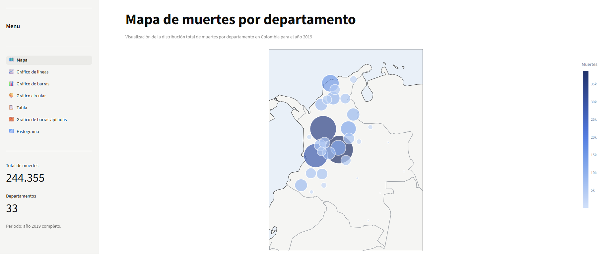
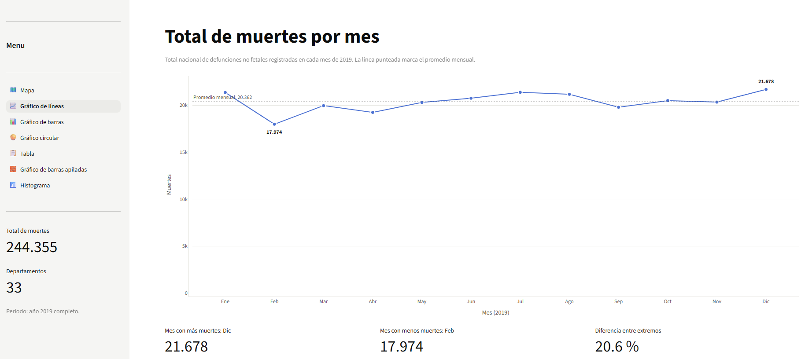
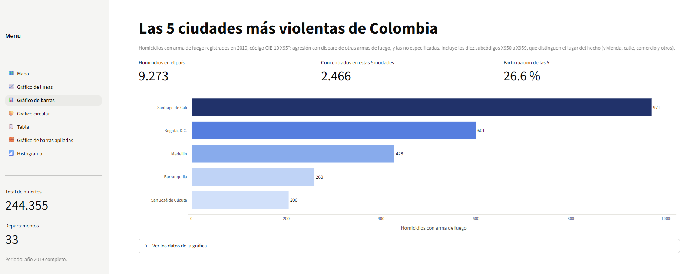
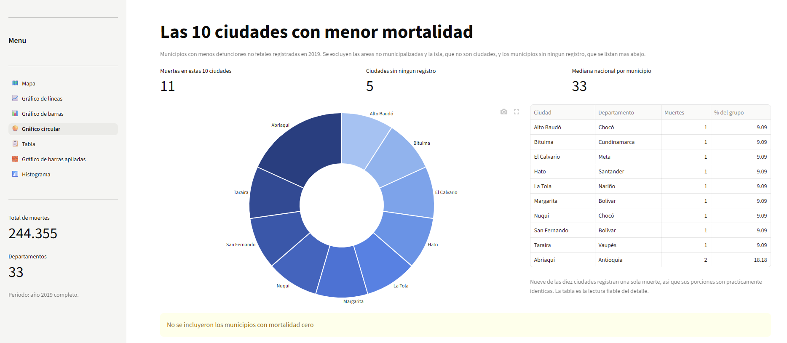
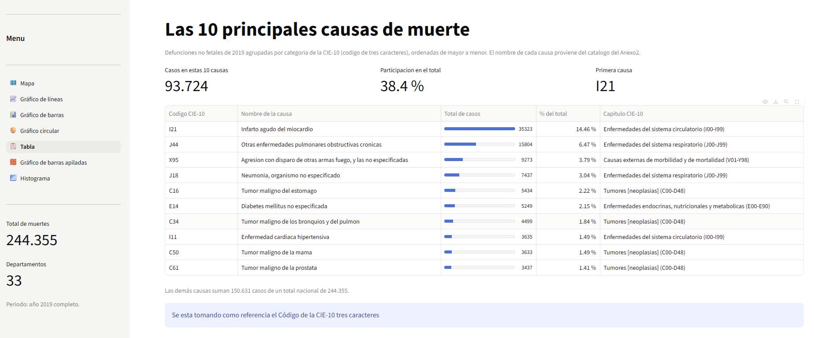
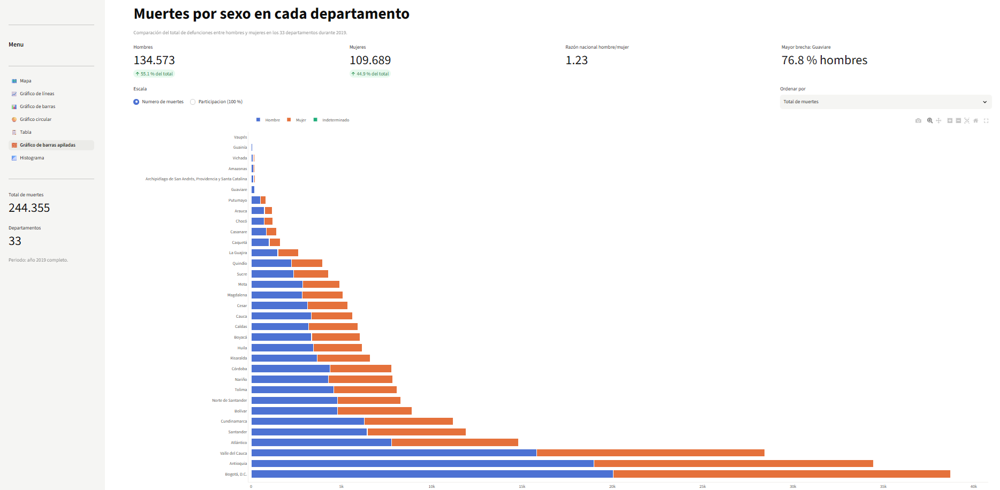
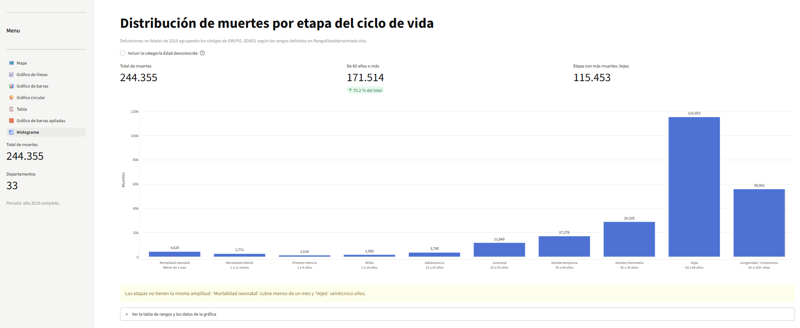

# Análisis de mortalidad en Colombia 2019 — Aplicación web con Streamlit y Plotly

**Integrantes:** LUISA FERNANDA YEPES ESPINOSA

**Aplicación desplegada:** <!-- TODO: pegar la URL pública cuando se despliegue -->
**Repositorio:** https://github.com/lyepes/mortalidad-colombia-2019/

---

## Introducción del proyecto

Esta aplicación web interactiva permite explorar las defunciones no fetales registradas en Colombia durante 2019, a partir de las Estadísticas Vitales del DANE. Reúne siete visualizaciones dinámicas (mapa, serie mensual, rankings de ciudades, tabla de causas, comparación por sexo e histograma por etapa del ciclo de vida) que facilitan identificar patrones demográficos, temporales y regionales de la mortalidad.

El tablero procesa **244.355 registros individuales de defunción** y los cruza con el catálogo CIE-10 de causas de muerte y con la división político-administrativa oficial (DIVIPOLA).

## Objetivo

Analizar la distribución de la mortalidad en Colombia en 2019 por departamento, mes, municipio, causa, sexo y etapa del ciclo de vida, mediante un tablero interactivo desarrollado en Python, de modo que cualquier persona pueda consultarlo en línea.

## Estructura del proyecto

```
.
├── src/
│   ├── principal.py        # Punto de entrada: menú de navegación (st.navigation)
│   ├── datos.py            # Carga cacheada, paleta de color y utilidades compartidas
│   ├── mapa.py             # Vista 1: mapa de burbujas por departamento
│   ├── lineas.py           # Vista 2: total de muertes por mes
│   ├── barras.py           # Vista 3: 5 ciudades más violentas
│   ├── circular.py         # Vista 4: 10 ciudades con menor mortalidad
│   ├── tabla.py            # Vista 5: 10 principales causas de muerte
│   ├── apiladas.py         # Vista 6: muertes por sexo en cada departamento
│   └── histograma.py       # Vista 7: distribución por etapa del ciclo de vida
├── data/
│   ├── Anexo1.NoFetal2019_CE_15-03-23.xlsx      # Microdatos de mortalidad no fetal 2019
│   ├── Anexo2.CodigosDeMuerte_CE_15-03-23.xlsx  # Catálogo CIE-10 de causas de muerte
│   ├── Divipola_CE_.xlsx                        # División político-administrativa
│   └── RangoEdadAproximado.xlsx                 # Etapas del ciclo de vida
├── .streamlit/
│   └── config.toml         # Tema claro fijo (SÍ se versiona)
├── .gitignore              # Excluye venv/ y archivos de caché
├── requirements.txt        # Dependencias con versiones
└── README.md
```

La carpeta `venv/` **no se sube al repositorio**: son 409 MB de binarios compilados
para un sistema concreto y se reconstruye con `pip install -r requirements.txt`.
En cambio `.streamlit/config.toml` **sí se versiona**, porque es configuración del
proyecto: sin él la aplicación desplegada pierde el tema claro.

Cada vista vive en su propio archivo y comparte la carga de datos a través de `datos.py`. Como las funciones de carga están decoradas con `@st.cache_data`, el Anexo1 (19 MB) se lee **una sola vez por sesión** aunque se visiten todas las vistas.

## Requisitos

- Python 3.10 o superior (desarrollado con 3.14.2)
- Librerías:

| Librería | Uso |
|---|---|
| `streamlit` | Framework de la aplicación web y navegación multipágina |
| `plotly` | Gráficos interactivos |
| `pandas` | Carga y transformación de datos |
| `openpyxl` | Lectura de archivos `.xlsx` |
| `numpy` | Operaciones numéricas auxiliares |

Contenido de `requirements.txt`:

```
streamlit==1.66.1
pandas==3.1.0
plotly==7.1.0
openpyxl==3.1.5
numpy==2.5.4
```

## Instalación

Para ejecutar la aplicación localmente:

```bash
# 1. Clonar el repositorio
git clone <URL-del-repositorio>
cd Actividad4_LuisaYepes

# 2. Crear y activar un entorno virtual
python -m venv venv
venv\Scripts\activate           # En Linux o macOS: source venv/bin/activate

# 3. Instalar dependencias
pip install -r requirements.txt

# 4. Ejecutar la aplicación desde la raíz del proyecto
streamlit run src/principal.py
```

Luego abre <http://localhost:8501> en el navegador (Streamlit suele abrirlo solo).

> **Importante:** ejecutar siempre desde la **raíz del proyecto**, no desde `src/`. Streamlit busca `.streamlit/config.toml` en el directorio desde donde se lanza el comando; si se ejecuta dentro de `src/`, no encontrará el tema claro.

> Al modificar `datos.py` hay que **reiniciar el servidor** (Ctrl+C y volver a lanzarlo). El botón *Rerun* reejecuta las páginas pero no reimporta los módulos ya cargados en memoria.

## Despliegue

### Streamlit Community Cloud (recomendado)

1. Subir el proyecto a GitHub con la carpeta `src/`, `data/`, `.streamlit/` y `requirements.txt`.
2. Entrar a [share.streamlit.io](https://share.streamlit.io) e iniciar sesión con la cuenta de GitHub.
3. Pulsar **New app** y seleccionar el repositorio y la rama.
4. En **Main file path**, indicar `src/principal.py`.
5. Pulsar **Deploy**. La plataforma instala `requirements.txt` y publica la URL pública.

No hace falta `Procfile`, `gunicorn` ni exponer un servidor WSGI: Streamlit trae su propio servidor.

### Render (alternativa)

Crear un **Web Service** con:

- **Runtime:** Python 3
- **Build Command:** `pip install -r requirements.txt`
- **Start Command:** `streamlit run src/principal.py --server.port $PORT --server.address 0.0.0.0`

El puerto debe tomarse de la variable `$PORT` que asigna la plataforma.

## Software

- **Python** — lenguaje de programación
- **Streamlit** — aplicación web dinámica y navegación multipágina
- **Plotly** — visualización interactiva
- **Pandas** — análisis de datos
- **Git y GitHub** — control de versiones y repositorio

## Visualizaciones con explicaciones de los resultados

> Las capturas deben guardarse en una carpeta `assets/` con los nombres indicados en cada bloque.

### 1. Mapa: muertes totales por departamento



Mapa de burbujas donde cada departamento se ubica en su centroide, calculado como el promedio de las coordenadas de sus municipios en DIVIPOLA (Hoja3), y el área de la burbuja es proporcional al total de muertes.

**Hallazgo:** la mortalidad se concentra fuertemente en los tres departamentos más poblados, que suman el 41,6 % del total: Bogotá (38.760), Antioquia (34.473) y Valle del Cauca (28.443). En el extremo opuesto, Vaupés (87), Guainía (115), Vichada (188) y Amazonas (190) registran cifras tres órdenes de magnitud menores. La diferencia refleja sobre todo el tamaño de la población, no el riesgo de morir.

### 2. Gráfico de líneas: muertes por mes



Serie mensual del total nacional, con línea de referencia en el promedio (20.363 muertes por mes).

**Hallazgo:** la mortalidad total es poco estacional. El máximo es diciembre (21.678) y el mínimo febrero (17.974), una diferencia de apenas 20,6 % entre extremos. Febrero aparece bajo en buena parte porque tiene 28 días: al comparar meses hay que tener en cuenta su duración.

### 3. Gráfico de barras: 5 ciudades más violentas



Ranking de las cinco ciudades con más homicidios por arma de fuego, código CIE-10 **X95** ("agresión con disparo de otras armas de fuego, y las no especificadas"). Se agrupan los diez subcódigos X950–X959, que solo se diferencian por el lugar del hecho.

**Hallazgo:** Santiago de Cali encabeza con 971 casos, seguida de Bogotá (601), Medellín (428), Barranquilla (260) y Cúcuta (206). Juntas concentran 2.466 de los 9.273 homicidios con arma de fuego del país (26,6 %). Cali registra un 62 % más de casos que Bogotá teniendo alrededor de una cuarta parte de su población, lo que sí indica una violencia relativa mucho mayor.

### 4. Gráfico circular: 10 ciudades con menor mortalidad



Participación de los diez municipios con menos defunciones registradas.

**Hallazgo:** nueve de las diez ciudades registran **una sola muerte** en todo el año (Alto Baudó, Bituima, El Calvario, Hato, La Tola, Margarita, Nuquí, San Fernando y Taraira) y la décima, Abriaquí, registra dos. Son municipios de muy baja población, de modo que la cifra no indica mejores condiciones de salud. Además, **13 entidades territoriales no registran ninguna muerte** —cinco municipios y ocho áreas no municipalizadas—, que se listan aparte porque un cero no se puede representar en una gráfica de participación y puede reflejar subregistro.

### 5. Tabla: 10 principales causas de muerte



Listado con código CIE-10, nombre y total de casos, ordenado de mayor a menor. La agrupación se hace al nivel de **categoría** (código de tres caracteres) porque el Anexo1 anota la causa unas veces con cuatro caracteres (I219) y otras con tres (C61): 22.735 de los 244.355 registros usan la forma corta, de modo que agrupar a tres caracteres evita partir una misma causa en varias filas y permite nombrar el 100 % de los registros.

| # | Código | Causa | Casos | % |
|---|---|---|---|---|
| 1 | I21 | Infarto agudo del miocardio | 35.323 | 14,46 |
| 2 | J44 | Otras enfermedades pulmonares obstructivas crónicas | 15.804 | 6,47 |
| 3 | X95 | Agresión con disparo de armas de fuego | 9.273 | 3,79 |
| 4 | J18 | Neumonía, organismo no especificado | 7.437 | 3,04 |
| 5 | C16 | Tumor maligno del estómago | 5.434 | 2,22 |
| 6 | E14 | Diabetes mellitus no especificada | 5.249 | 2,15 |
| 7 | C34 | Tumor maligno de los bronquios y del pulmón | 4.499 | 1,84 |
| 8 | I11 | Enfermedad cardíaca hipertensiva | 3.635 | 1,49 |
| 9 | C50 | Tumor maligno de la mama | 3.633 | 1,49 |
| 10 | C61 | Tumor maligno de la próstata | 3.437 | 1,41 |

**Hallazgo:** el infarto agudo del miocardio es la primera causa por amplio margen, con más del doble de casos que la segunda. Las diez principales causas suman 93.724 defunciones, el 38,36 % del total nacional. Destaca que una causa externa (X95, homicidio por arma de fuego) aparezca en el tercer lugar, por delante de la neumonía y de todos los tumores.

### 6. Barras apiladas: muertes por sexo y departamento



Comparación de hombres y mujeres en los 33 departamentos, con dos escalas (número de muertes y participación al 100 %) y dos ordenamientos (por total o por proporción de hombres).

**Hallazgo:** en **los 33 departamentos mueren más hombres que mujeres**, sin una sola excepción. A nivel nacional son 134.573 hombres (55,1 %) frente a 109.689 mujeres (44,9 %), una razón de 1,23. La brecha varía mucho: va del 51,7 % de hombres en Bogotá al 76,8 % en Guaviare (razón de 3,36). Los departamentos con mayor brecha son los de la Amazonia y la Orinoquia (Guaviare, Guainía, Amazonas, Vichada, Putumayo, Arauca, Caquetá) más Chocó, donde pesan más las muertes violentas y accidentales, que afectan sobre todo a hombres jóvenes.

### 7. Histograma: muertes por etapa del ciclo de vida



Distribución agrupando los códigos de `GRUPO_EDAD1` según los rangos definidos en `RangoEdadAproximado.xlsx`. Los rangos cubren los códigos 0 a 29 sin huecos ni solapes, de modo que ningún registro queda sin clasificar.

| Etapa | Códigos | Edad | Muertes | % |
|---|---|---|---|---|
| Mortalidad neonatal | 0–4 | Menor de 1 mes | 4.520 | 1,85 |
| Mortalidad infantil | 5–6 | 1 a 11 meses | 2.771 | 1,13 |
| Primera infancia | 7–8 | 1 a 4 años | 1.518 | 0,62 |
| Niñez | 9–10 | 5 a 14 años | 1.993 | 0,82 |
| Adolescencia | 11 | 15 a 19 años | 3.795 | 1,55 |
| Juventud | 12–13 | 20 a 29 años | 11.840 | 4,85 |
| Adultez temprana | 14–16 | 30 a 44 años | 17.276 | 7,07 |
| Adultez intermedia | 17–19 | 45 a 59 años | 29.105 | 11,91 |
| Vejez | 20–24 | 60 a 84 años | 115.453 | 47,25 |
| Longevidad / Centenarios | 25–28 | 85 a 100+ años | 56.061 | 22,94 |
| Edad desconocida | 29 | Sin información | 23 | 0,01 |

**Hallazgo:** la mortalidad se concentra al final de la vida — vejez y longevidad suman 171.514 muertes, el **70,2 %** del total. La curva tiene forma de J: arranca alta en el primer mes de vida (4.520 muertes), cae al mínimo en la primera infancia (1.518) y vuelve a subir sin interrupción hasta la vejez. Dos detalles notables: el primer mes de vida acumula más muertes que todo el rango de 15 a 19 años (4.520 contra 3.795), pese a comparar un mes contra cinco años; y entre adolescencia y juventud las muertes se multiplican por 3,1, un salto donde pesan las muertes violentas.

> **Nota metodológica:** las etapas no tienen la misma amplitud ("Mortalidad neonatal" cubre menos de un mes y "Vejez" veinticinco años), por lo que la altura de las barras mide cuántas muertes ocurren en cada etapa, no el riesgo de morir dentro de ella.

## Limitaciones

- Todas las cifras son **conteos absolutos, no tasas**. Los archivos del DANE utilizados no incluyen población, de modo que no es posible calcular índices por cada 100.000 habitantes. Esto afecta especialmente a los rankings de ciudades: las más grandes aparecen arriba en parte por su tamaño.
- El municipio registrado es el de **defunción**, que no siempre coincide con el lugar donde ocurrió el hecho (por ejemplo, un traslado a un hospital de otra ciudad).
- Un conteo bajo puede reflejar tanto ausencia real de defunciones como **subregistro**.
- Las variables `ESTADO_CIVIL` y `NIVEL_EDUCATIVO` no se utilizan porque sus descripciones no vienen en los anexos.
- El registro `94663` (Mapiripana, Guainía) existe en el Anexo1 pero no en la Hoja3 de DIVIPOLA, por lo que queda fuera de las agregaciones por municipio; sí está contado en las agregaciones por departamento.

## Fuente de los datos

Departamento Administrativo Nacional de Estadística (DANE), [Estadísticas Vitales (EEVV) 2019](https://www.dane.gov.co/index.php/estadisticas-por-tema/salud/nacimientos-y-defunciones/defunciones-no-fetales).
